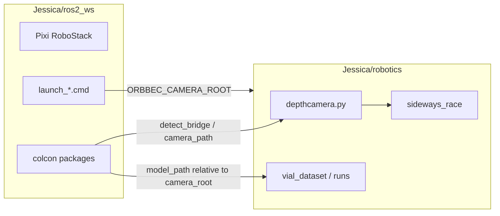

# Split ROS workspace vs robotics stack (Jessica)

**Answer: YES** — you can put colcon/ROS under `Jessica/ros2_ws/` (or `Jessica/ros/`) and the Orbbec/YOLO/datasets stack under `Jessica/robotics/` (today’s `Camera/` contents minus `ros2_ws/`). Runtime already centers on **`ORBBEC_CAMERA_ROOT`** for cross-tree imports; launch scripts only need to stop assuming “parent of `ros2_ws` = camera root.”

## Executed (2026-10-12)

The split is complete:

```text
E:\Desktop\Jessica\ros2_ws
E:\Desktop\Jessica\robotics
```

`Camera/` was removed after migration. Launch/build helpers set
`ORBBEC_CAMERA_ROOT=E:\Desktop\Jessica\robotics`; Python fallbacks also check
the sibling `robotics/` folder. The moved Pixi environment was reinstalled to
rewrite its embedded absolute prefixes, and both ROS packages were rebuilt.

```powershell
cd E:\Desktop\Jessica\ros2_ws
.\launch_r2_10.cmd run_offline:=false
.\launch_dual_sync.cmd

cd E:\Desktop\Jessica\robotics
python depthcamera.py --dual-independent
```

Do not run the two ROS camera launch stacks simultaneously.

---

## 1. Current layout under `Camera/`

| Area | Paths | Role |
|------|--------|------|
| **ROS 2 / Pixi / colcon** | `Camera/ros2_ws/` — `pixi.toml`, `.pixi/`, `build/`, `install/`, `src/*` (21 packages), `launch_*.cmd/ps1`, `_ros_env.*`, `build.*` | RoboStack env, `colcon build`, `ros2 launch` |
| **Live camera + detection core** | `depthcamera.py`, `run_dual_independent.py`, `local_approx_sync.py`, `stereo_extrinsics.json`, `camera_gates.json`, `yolov8*.pt` | Non-ROS and shared logic imported by ROS nodes |
| **Training / eval (plain Python)** | `train_vial_model.py`, `vial_3d_*.py`, `eval_*.py`, `test_*.py`, `make_split_*.py` | Offline; cwd = robotics root |
| **Data & weights** | `vial_dataset/`, `runs/`, `vial_photos/`, `assets/` | Paths relative to robotics root |
| **Sideways research** | `sideways_race/` (`methods/`, `synth/`, `results/`) | Imported as `sideways_race.*` when robotics root is on `sys.path` |
| **Competition / notes** | `ros2_vial_competition/`, `plan_research/`, `*.md`, metrics JSON | Docs and experiments; not required at runtime |
| **Out of scope** | `Jessica/gdi/` (printer driver tree) | Unrelated to camera/ROS |

**ROS packages in `ros2_ws/src/`:** `orbbec_dual_sync`, `agent_01`…`agent_10`, `r2_01`…`r2_10`.

---

## 2. Coupling (what ties the trees together)

### Primary bridge (must keep working)

| Mechanism | Behavior today | After split |
|-----------|----------------|-------------|
| **`ORBBEC_CAMERA_ROOT`** | Set by `_ros_env.ps1` / `launch_*.cmd` to `%ROS_WS_ROOT%\..` (i.e. `Camera/`) | Must point at **`Jessica/robotics/`** (not parent of `ros2_ws` if that parent is `Jessica/`) |
| **`camera_path.ensure_camera_on_path()`** | Adds robotics root to `sys.path`; imports `depthcamera` | Same; env var or sibling discovery (see below) |
| **`detect_bridge` → `depthcamera`** | Worker subprocess runs locate helpers in `depthcamera.py` | Unchanged if `ORBBEC_CAMERA_ROOT` is set |
| **`depthcamera.py` → `sideways_race`** | `from sideways_race.methods...` needs robotics root on path | Same |

### Heuristics that **break** when `ros2_ws` is no longer a child of robotics

Many packages use `Path(__file__).resolve().parents[4]` as fallback “Camera root”:

`.../ros2_ws/src/<pkg>/<pkg>/module.py` → `parents[4]` = **parent of `ros2_ws`**.

- Today: `Camera/` ✓  
- After split: `Jessica/` ✗ (no `depthcamera.py`, no `vial_dataset/`)

**Mitigation:** always set `ORBBEC_CAMERA_ROOT` in launch scripts, and/or teach `default_camera_root()` / `camera_path.py` to check:

1. `ORBBEC_CAMERA_ROOT` (and optional alias `JESSICA_ROBOTICS_ROOT`)
2. `Path(ros2_ws)/../robotics` if `depthcamera.py` exists there
3. Legacy `../Camera`
4. Walk parents for `depthcamera.py` or `(vial_dataset/ + runs/)`

### Launch / env scripts

| File | Assumption |
|------|------------|
| `_ros_env.ps1` | `Get-CameraRoot` = `Join-Path $RosWsRoot ".."` |
| `launch_dual_sync.cmd`, `launch_r2_10.cmd` | `ORBBEC_CAMERA_ROOT=%ROS_WS_ROOT%\..` |
| `build.sh` | Documents `export ORBBEC_CAMERA_ROOT=$(cd $ROOT/.. && pwd)` |

All need **explicit robotics path** (env file or sibling folder name).

### Hard-coded `E:\Desktop\Jessica\Camera`

- **Runtime-critical:** ~15× `config/params.yaml` and `vial_detector_node.py` default parameters (`camera_root`, `model_path`, `dataset_path`).
- **Non-runtime:** hundreds of eval JSON / train YAML / README examples / docstrings in Python headers.

Prefer empty defaults + read env in nodes, or launch-time overrides: `camera_root:=$(env ORBBEC_CAMERA_ROOT)`.

### `local_approx_sync.py` (debug, non-ROS)

Hard-wires:

```text
ROOT = Camera/
PKG = ROOT / "ros2_ws" / "src" / "orbbec_dual_sync"
```

After split: point at `Jessica/ros2_ws/src/...` and set `ORBBEC_CAMERA_ROOT` to robotics.

### Pixi

Lives **inside** `ros2_ws/`; no dependency on robotics folder layout except launch scripts. Moving the whole `ros2_ws` directory is fine; run `colcon build` once from the new path (install prefixes may contain old absolute paths).

### PYTHONPATH

Only mentioned in agent READMEs for standalone dev — not part of the main launch path.

---

## 3. Proposed two-folder layout

```text
Jessica/
├── robotics/                    # rename from Camera/ (everything except ros2_ws)
│   ├── depthcamera.py
│   ├── sideways_race/
│   ├── vial_dataset/
│   ├── runs/
│   ├── train_vial_model.py
│   ├── local_approx_sync.py     # update paths to ../ros2_ws
│   └── …
├── ros2_ws/                     # move from Camera/ros2_ws
│   ├── pixi.toml
│   ├── src/
│   ├── install/                 # rebuild recommended after move
│   └── launch_*.cmd
├── jessica.env.ps1              # optional: single source of truth
└── SPLIT_PLAN.md                # this file
```

Optional compatibility symlink for a transition period:

```text
Jessica/Camera  →  robotics   (or junction on Windows)
```

Then `%ROS_WS_ROOT%\..` still works until scripts are updated.

---

## 4. Minimal changes for “it works”

### Phase A — move + env (required)

1. Move `Camera/ros2_ws` → `Jessica/ros2_ws`.
2. Move remaining `Camera/*` → `Jessica/robotics/` (or rename `Camera` → `robotics` in place and move `ros2_ws` up).
3. Add `Jessica/jessica.env.ps1` (or `.env` consumed by cmd):

   ```powershell
   $env:JESSICA_ROOT = "E:\Desktop\Jessica"   # or detect from script location
   $env:ORBBEC_CAMERA_ROOT = "$env:JESSICA_ROOT\robotics"
   ```

4. Update `_ros_env.ps1` / `launch_*.cmd` / `run_dual_sync.ps1` / `launch_r2_10.ps1`:

   - `Set-OrbbecCameraRoot` → robotics path (env override > `Join-Path $JessicaRoot "robotics"` > legacy `..\Camera`).
5. **`camera_path.py`**: add sibling `../robotics` before `parents[4]`; document that env is required if layout is nonstandard.
6. **`local_approx_sync.py`**: `ROS_WS = JESSICA_ROOT / "ros2_ws"` (or env `JESSICA_ROS_WS`).
7. Re-run `colcon build` from new `ros2_ws` (Windows: `build.cmd` / `build_r2_10.cmd`).

### Phase B — robust defaults (recommended, small code sweep)

1. One shared helper (e.g. in `orbbec_dual_sync.camera_path` or tiny `jessica_paths` module copied into packages):

   ```python
   def default_robotics_root() -> Path:
       for key in ("ORBBEC_CAMERA_ROOT", "JESSICA_ROBOTICS_ROOT"):
           if v := os.environ.get(key):
               return Path(v).resolve()
       # sibling robotics, legacy Camera, marker walk ...
   ```

2. Replace `parents[4]` fallbacks in `agent_*` / `r2_*` `default_camera_root()` with call to shared logic (or env-first one-liner).
3. ROS params: set `camera_root: ""` in YAML; in `vial_detector_node`, default to `os.environ.get("ORBBEC_CAMERA_ROOT", "")`.
4. Launch files: pass `camera_root:=$ORBBEC_CAMERA_ROOT` where supported, or rely on node env read.

### Phase C — docs / hygiene (optional)

- Update `ROS_SYNC.md`, docstring `cd E:\...` lines, READMEs.
- Leave eval JSON paths as historical artifacts unless you re-run evals.

---

## 5. Effort, risks, verification

| Item | Estimate |
|------|----------|
| Physical move + env/launch script updates | **1–2 hours** |
| `camera_path` + `local_approx_sync` + central root helper | **2–4 hours** |
| Sweep `default_camera_root` / params.yaml / node defaults | **3–6 hours** (many files, mechanical) |
| Full colcon rebuild + smoke tests | **1–2 hours** |

**Risks**

- Forgetting to set `ORBBEC_CAMERA_ROOT` → import errors for `depthcamera` / `sideways_race`.
- Stale **hard-coded** paths in `params.yaml` if Phase B skipped → nodes look for weights under old `Camera/`.
- **Absolute paths** inside `install/` and some generated YOLO `data.yaml` — fixed by rebuild/re-prepare datasets, not by move alone.
- Two launch stacks (`launch_dual_sync` vs `launch_r2_10`) still must not run together (unchanged).

**Smoke checklist**

1. `$env:ORBBEC_CAMERA_ROOT = E:\Desktop\Jessica\robotics`
2. `cd E:\Desktop\Jessica\ros2_ws` → `.\launch_dual_sync.cmd` (or offline r2_10 replay).
3. `cd robotics` → `python depthcamera.py --list-cameras`
4. `python local_approx_sync.py` (if used)
5. One `ros2_ws/src/r2_10_fusion_multiorient/scripts/evaluate.py --camera-root %ORBBEC_CAMERA_ROOT%`

---

## 6. Architecture (after split)



---

## Summary

| Question | Answer |
|----------|--------|
| Can they separate? | **Yes** |
| How? | Robotics root via **`ORBBEC_CAMERA_ROOT`** (sibling of `ros2_ws`); fix launch env + `parents[4]` heuristics |
| Move files now? | **Not required** for planning; use junction/symlink for zero-code trial |
| Blocker? | None architectural — mostly path/env consistency |
